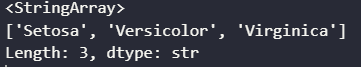
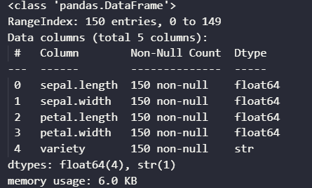
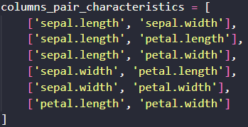
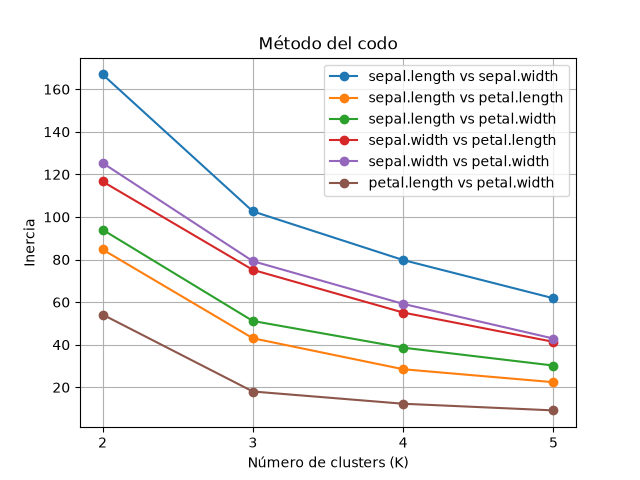
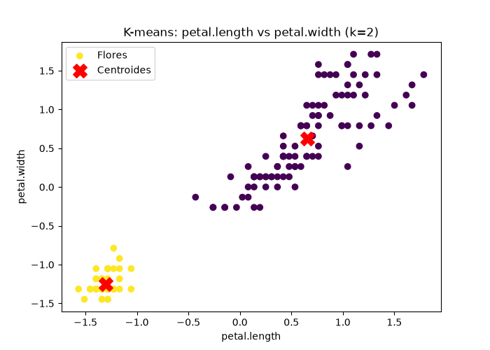
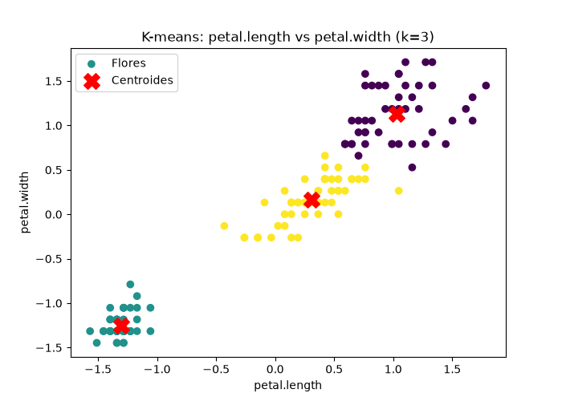
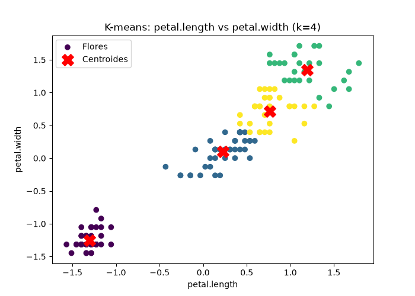
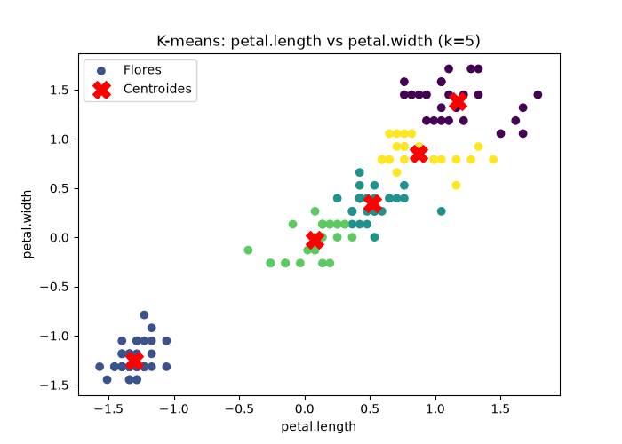

# K-means Algorithm - Iris Dataset

## Description
> This project consists of applying the k-means algorithm, an unsupervised machine learning algorithm, to the iris.csv dataset.
> 
> The objective is to identify flower clusters based on their characteristics and visually analyze the results obtained.
>The Iris dataset contains four numerical characteristics of the flowers: sepal length and width, and petal length and width.
> 
>It also has a column called `variety`, which identifies the three flower species: Setosa, Versicolor, and Virginica.
> 
>However, since K-Means is an unsupervised learning algorithm, we will not use the `variety` column during training. Instead, we will work solely with the numerical characteristics to identify natural groupings in the data.
> 
>The objective will be to experiment with different numbers of clusters (K) and analyze whether K = 3 represents an adequate number of clusters, considering that the dataset contains three real species.
> 
>Subsequently, we will be able to compare the resulting clusters with the original classifications to assess their similarity.

The variety column contains three labels that represent the classification of each flower according to its species:


`The iris.csv contains 150 instances of flowers`


## Objectives
- Perform EDA



- Select feature pairs for better visualization in a 2D graph


- Apply standardization using StandardScaler
- Implement the K-means algorithm
- Determine the appropriate number of clusters using the elbow method



## Cluster Visualization
> The following visualizations show how K-Means groups the Iris dataset using different K values, from 2 to 5, on one of the feature pairs.
>
>As we can see, K = 3 provides a meaningful clustering of the data, as it allows us to identify three clusters that can be compared to the three actual Iris species.
> 
> 
> 
> 

## Technologies

- Python
- Pandas
- NumPy
- Matplotlib
- Scikit-learn
- Visual Studio Code

## Installation & Execution

1. **Clone the repository:**
   ```bash
   git clone https://github.com/kaav-ai/K-means-Algorithm---Iris-Dataset.git
2. **Install dependencies:**
   ```bash
   pip install -r requirements.txt
3. **Run the script:**
   ```bash
   python kmeans.py

## Project structure

- ├── elbow_method
- │   └── elbow_method.png
- ├── graphic_pairs
- │   └── 24 IMAGES
- │       └── {sc[0]}_vs_{sc[1]}_cluster{v}.png
- ├── iris.csv
- ├── kmeans.py
- ├── README.md
- ├── requirements.txt
- └── .gitignore


